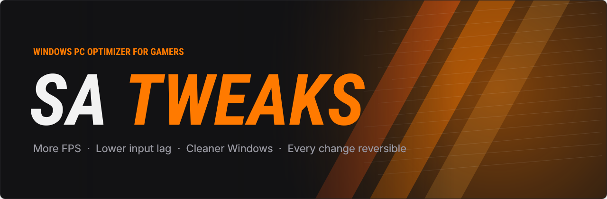
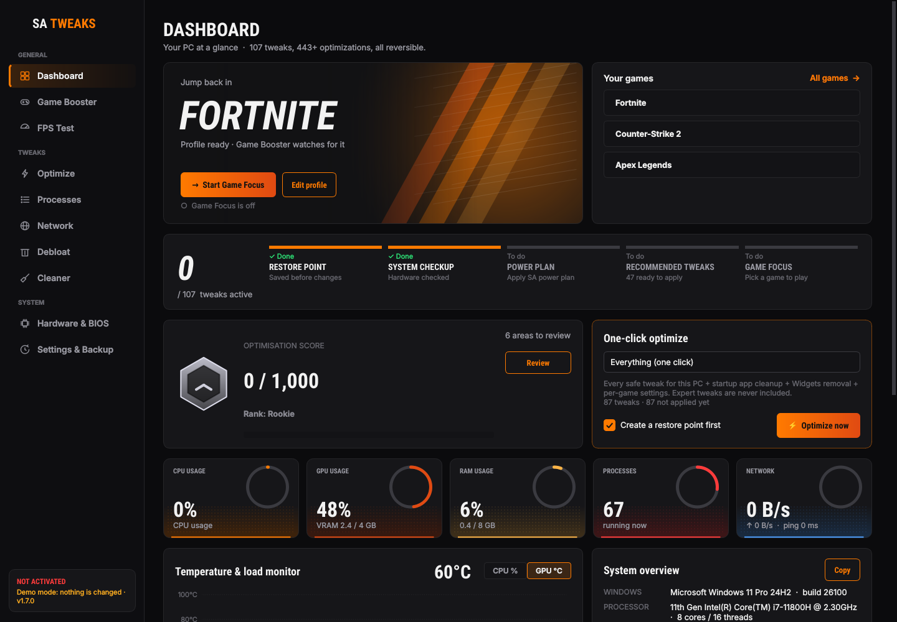
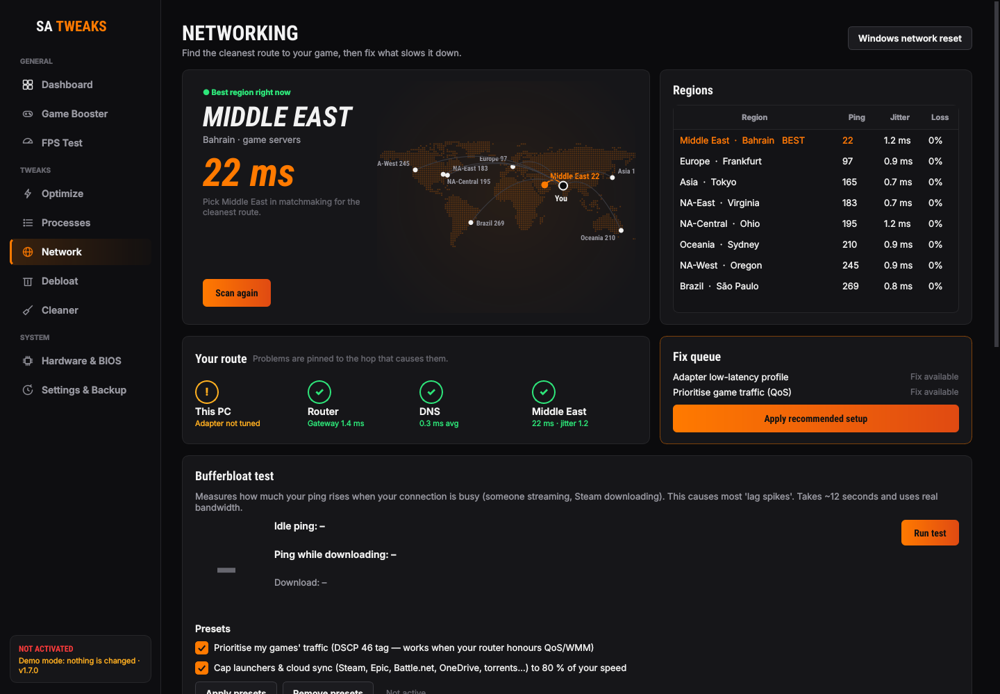
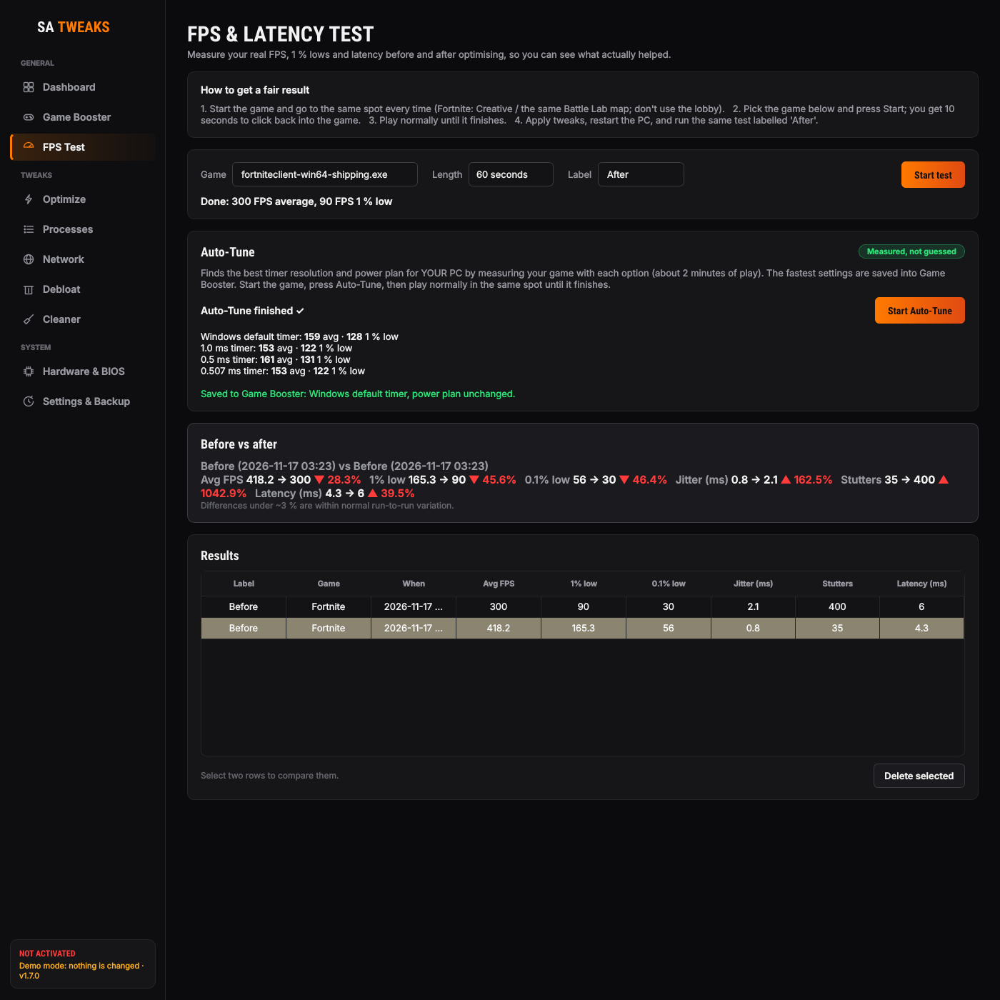

  

  
  &nbsp;
  
  &nbsp;
  

<h3 align="center">More FPS. Lower input lag. Cleaner Windows. Every change reversible.</h3>

---

## Why SA Tweaks

Most PC optimizers promise "+300 FPS" and never prove it. SA Tweaks **measures your real FPS before and after**, keeps only what actually helps on *your* PC, and can undo every single change with one click.

|  |  |
|---|---|
| ⚡ **One-click optimize** | Every safe tweak for your hardware, applied in seconds, with a restore point first |
| 🎮 **Game Booster** | Detects when your game starts, boosts it, and puts everything back when you quit |
| 📊 **FPS & latency test** | Real average FPS, 1 % lows, stutters and input latency, before vs after |
| 🧠 **Auto-Tune** | Plays through the options with you and keeps whichever is fastest on your PC |
| 🛡️ **Slowdown protection** | If a change ever makes your game slower, SA Tweaks spots it and undoes it |
| 🌍 **Network region finder** | Live ping, jitter and packet loss to every game region, plus one-click network fixes |
| 🧹 **Debloat & cleaner** | Removes pre-installed junk, startup clutter and gigabytes of caches |
| 🔧 **Hardware & BIOS check** | Finds RAM running below its speed, wrong refresh rate and other free FPS left on the table |
| ↩️ **100 % reversible** | Every change is recorded and can be undone, even after updates |
| 🔄 **Automatic updates** | New features install themselves in about 30 seconds |

---

## Screenshots

  

  
  

---

## Get SA Tweaks

1. **Download** the installer with the button above and run it.
2. Open SA Tweaks. It shows your **Machine ID**.
3. Email your Machine ID to **s7me3r@gmail.com** to buy a licence. Your key arrives by email.
4. Paste the key, click **Activate**, and you're done.

Each licence works on one PC. Multi-PC licences are available.

---

## FAQ

**Is it safe?**
SA Tweaks creates a Windows restore point before making changes, labels every tweak with its real impact and risk, and can undo everything with one click. Risky tweaks are hidden unless you turn on Expert mode.

**Will it get me banned?**
No. SA Tweaks changes Windows settings only. It never touches game files or game memory, and it works alongside Easy Anti-Cheat, BattlEye, Vanguard and FACEIT.

**Does it work on laptops?**
Yes. SA Tweaks detects laptops and adjusts its power and service settings, so battery life isn't wrecked when you're unplugged.

**Windows says "Windows protected your PC".**
That message appears for new apps. Click **More info → Run anyway**.

---

© 2026 SA · SA Tweaks is not affiliated with Microsoft or any game publisher.

